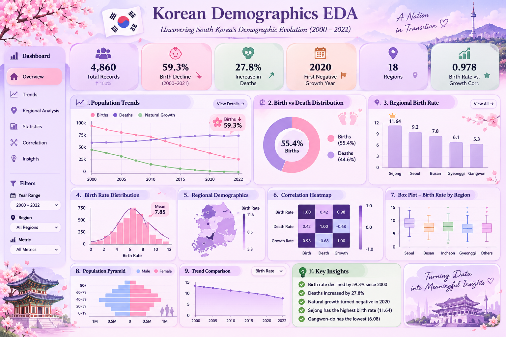

# 🇰🇷 Korean Demographics EDA
### Uncovering South Korea's Demographic Evolution (2000–2022)

<p align="center">
  
</p>

<p align="center">
  
</p>

<p align="center">
  
  
  
  
</p>

---

## 📌 Project Overview

**Korean Demographics EDA** is a data analysis project focused on understanding the demographic evolution of South Korea from 2000 to 2022.

South Korea has experienced significant demographic changes over the past two decades, including declining birth rates, increasing deaths, and changes in natural population growth.

This project uses Exploratory Data Analysis (EDA) to investigate these patterns, identify regional differences, explore relationships between demographic variables, and communicate meaningful insights through data visualization.

### 🎯 Project Objectives

- Analyze birth and death trends over time.
- Understand changes in natural population growth.
- Compare demographic patterns across regions.
- Explore birth-rate and death-rate distributions.
- Identify relationships between demographic indicators.
- Discover meaningful patterns through statistical analysis and visualization.

---

## 📊 Dashboard Preview

<p align="center">
  
</p>

<p align="center">
  <i>A visual overview of demographic indicators, trends, regional comparisons, and statistical insights.</i>
</p>

> **Note:** Add your dashboard image to `screenshots/dashboard.png`. The image is a visual overview; the actual analysis and results are documented in the Jupyter Notebook.

---

## 📈 Key Highlights

<table>
<tr>
<td align="center" width="33%">
<h2>4,860</h2>
<b>Total Records</b><br/>
<sub>Dataset observations</sub>
</td>
<td align="center" width="33%">
<h2>18</h2>
<b>Regions</b><br/>
<sub>Regional coverage</sub>
</td>
<td align="center" width="33%">
<h2>2000–2022</h2>
<b>Time Period</b><br/>
<sub>Demographic analysis</sub>
</td>
</tr>
<tr>
<td align="center">
<h2>59.3%</h2>
<b>Birth Decline</b><br/>
<sub>2000–2021</sub>
</td>
<td align="center">
<h2>27.8%</h2>
<b>Increase in Deaths</b><br/>
<sub>Compared with 2000</sub>
</td>
<td align="center">
<h2>2020</h2>
<b>Negative Growth</b><br/>
<sub>First negative annual average</sub>
</td>
</tr>
</table>

---

## 🔍 Exploratory Data Analysis

The project explores demographic information through multiple analytical dimensions.

### 1. Data Understanding
- Dataset loading and inspection
- Understanding rows and columns
- Data types and structural overview
- Statistical summaries

### 2. Data Cleaning
- Missing-value identification
- Duplicate-record checking
- Data-type verification
- Date-column preparation
- Data consistency checks

### 3. Univariate Analysis
- Birth distribution
- Death distribution
- Birth-rate distribution
- Death-rate distribution
- Natural-growth distribution

### 4. Bivariate Analysis
- Births vs. deaths
- Birth rate vs. natural growth rate
- Regional demographic comparisons
- Relationships between numerical variables

### 5. Time-Series Analysis
- Monthly birth trends
- Monthly death trends
- Natural population growth over time
- Long-term demographic changes

### 6. Regional Analysis
- Birth-rate comparison by region
- Death-rate comparison by region
- Regional natural-growth patterns
- Identification of demographic differences

---

## 📊 Data Visualizations

The analysis uses different visualization techniques to make demographic patterns easier to understand.

| Visualization | Purpose |
|---|---|
| Line Chart | Monthly birth and death trends |
| Bar Chart | Regional demographic comparison |
| Pie / Donut Chart | Proportional demographic summaries |
| Histogram | Distribution of demographic variables |
| Box Plot | Regional variation and outlier analysis |
| Scatter Plot | Relationships between demographic indicators |
| Heatmap | Correlation between numerical variables |
| Area Chart | Natural population growth patterns |

<p align="center">
  
  
  
  
</p>

---

## 💡 Key Findings

Based on the current exploratory analysis:

- **Declining Births:** South Korea experienced a substantial decline in births, with the analysis indicating a 59.3% decrease between 2000 and 2021.
- **Increasing Deaths:** The analysis indicates an increase of approximately 27.8% in deaths compared with 2000.
- **Negative Natural Growth:** The annual average natural population growth first became negative in 2020.
- **Regional Differences:** Sejong recorded the highest average birth rate in the analyzed regional comparison, while Gangwon-do recorded the lowest.
- **Strong Correlation:** Birth rate and natural growth rate showed a correlation of approximately 0.978 in the analyzed data.

These findings describe patterns in the dataset and should not be interpreted as proof of causation.

---

## 🛠️ Tech Stack

<p align="center">
  
</p>

| Technology | Usage |
|---|---|
| Python | Core programming language |
| Pandas | Data manipulation and analysis |
| NumPy | Numerical computations |
| Matplotlib | Data visualization |
| Seaborn | Statistical visualization |
| Jupyter Notebook | Interactive analysis environment |

---

## 📂 Project Structure

```text
Korean-Demographics-EDA/
│
├── 📁 screenshots/
│   └── dashboard.png
│
├── 📄 Korean_demographics_2000-2022.csv
│
├── 📓 South_Korea_Demographic_EDA.ipynb
│
├── 📄 README.md
│
└── 📄 requirements.txt
```

*Update the filenames in this structure if your actual repository uses different names.*

---

## ⚙️ Installation & Setup

Follow these steps to run the analysis locally.

**1. Clone the repository**

```bash
git clone https://github.com/PRAJITHAMARY/Korean-Demographics-EDA.git
```

**2. Navigate to the project directory**

```bash
cd Korean-Demographics-EDA
```

**3. Create a virtual environment (optional)**

```bash
python -m venv venv
```

**4. Activate the environment**

Windows:

```bash
venv\Scripts\activate
```

**5. Install the required libraries**

```bash
pip install pandas numpy matplotlib seaborn jupyter
```

**6. Launch Jupyter Notebook**

```bash
jupyter notebook
```

Open the demographic analysis notebook and run the cells to explore the results.

---

## 📚 Dataset Information

The project uses the **South Korean Demographics (2000–2022)** dataset.

- **Source:** Kaggle
- **Coverage:** South Korea
- **Period:** 2000–2022
- **Geographical Scope:** 18 regional categories, including national-level data
- **Frequency:** Monthly observations

**Dataset Link:**  
[South Korean Demographics 2000–2022 – Kaggle](https://www.kaggle.com/datasets/alexandrepetit881234/korean-demographics-20002022)

---

## 🚀 Future Enhancements

Potential improvements to extend this project:

- Build an interactive dashboard using Streamlit or Power BI.
- Add interactive filters for year, region, and demographic indicators.
- Explore population ageing and dependency ratios.
- Develop demographic forecasting models.
- Compare demographic changes across different regions.
- Add interactive geographical visualizations.
- Improve the visual storytelling of demographic insights.

---

## 🎓 Learning Outcomes

Through this project, I explored:

- Real-world dataset handling and preprocessing.
- Exploratory Data Analysis techniques.
- Statistical summaries and correlation analysis.
- Time-series trend exploration.
- Regional comparison techniques.
- Data visualization and analytical storytelling.
- Extracting meaningful insights from raw demographic data.

---

## 👩‍💻 Author

<p align="center">
  <b>Prajitha Mary</b><br/>
  Computer Science Engineering Student | Data Science & Analytics Enthusiast
</p>

<p align="center">
  <a href="https://github.com/PRAJITHAMARY">
    
  </a>
  <a href="https://www.linkedin.com/">
    
  </a>
</p>

---

<p align="center">
  <b>Turning Demographic Data Into Meaningful Insights.</b>
  <br/>
  <i>Every dataset tells a story. This project explores the story of a changing nation.</i>
</p>

<p align="center">
  
</p>
